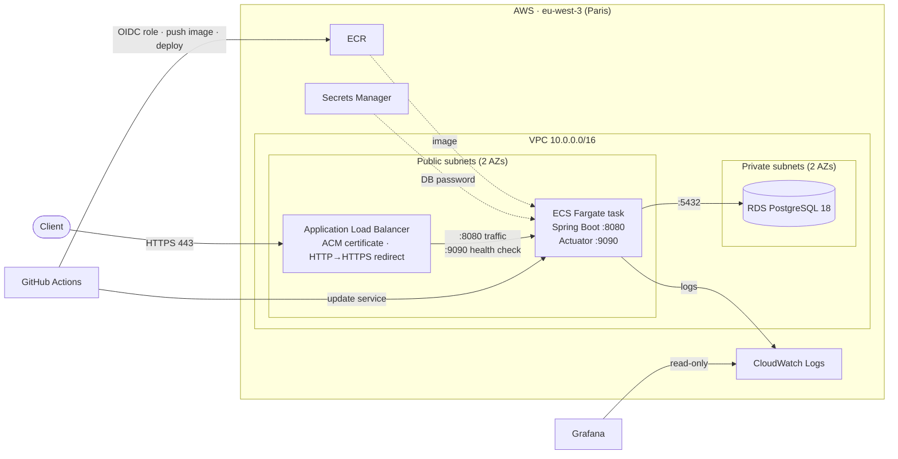
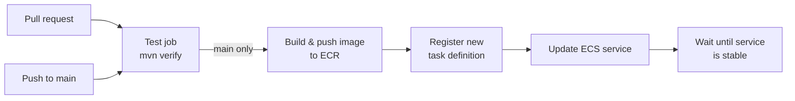

# Simple CRUD on AWS

A Spring Boot REST API deployed end to end on AWS: containerised with Docker, infrastructure defined in Terraform, deployed by GitHub Actions and monitored with CloudWatch and Grafana.

The application is deliberately small (a products CRUD). The focus of the project is everything around it: infrastructure as code, a secure CI/CD pipeline, and running the service in production.


## Architecture



| Layer | What is used |
| --- | --- |
| Application | Java 25, Spring Boot 4 (Web MVC, Data JPA, Actuator), PostgreSQL |
| Containers | Docker multi-stage build (Maven → Temurin 25 JRE Alpine), Docker Compose for local runs |
| Infrastructure | Terraform: VPC, subnets, security groups, ALB, ACM, ECS Fargate, RDS, IAM |
| CI/CD | GitHub Actions with OIDC (no stored AWS keys) |
| Observability | CloudWatch Logs, Grafana dashboards on CloudWatch data, Spring Boot Actuator health checks |

## API

Base path: `/api/products`

| Method | Path | Description | Success |
| --- | --- | --- | --- |
| `GET` | `/api/products` | List all products | `200` |
| `GET` | `/api/products/{id}` | Get one product | `200` / `404` |
| `POST` | `/api/products` | Create a product | `201` |
| `PUT` | `/api/products/{id}` | Update a product | `200` / `404` |
| `DELETE` | `/api/products/{id}` | Delete a product | `204` / `404` |

Example:

```bash
curl -X POST http://localhost:8080/api/products \
  -H "Content-Type: application/json" \
  -d '{"name":"Keyboard","description":"Mechanical keyboard","price":89.90,"quantity":10}'
```

## Run locally

Requirements: Docker.

```bash
docker compose up --build
```

- API: http://localhost:8080/api/products
- Health: http://localhost:8080/actuator/health

Run the tests (requires Java 25 and Maven):

```bash
cd app
mvn verify
```

## Deploy to AWS

### Prerequisites (created once, outside Terraform)

- An **ECR repository** named `simple-crud`
- A **Secrets Manager secret** `/dev/db/simpleCrud` with a `password` key (the database password)
- A domain whose DNS you control (this project uses Cloudflare)

### 1. Create the infrastructure

```bash
cd terraform/aws
terraform init
terraform apply -var="domain_name=example.com" -var="db_password=..."
```

Or put the values in `terraform.tfvars` (gitignored).

### 2. Validate the certificate and point the domain

- Add the CNAME records from the `acm_certificate_validation_records` output to your DNS.
- Point your domain to the `alb_dns_name` output.

### 3. Connect GitHub Actions

Save the `github_actions_role_arn` output as the `AWS_ROLE_ARN` secret in the GitHub repository. From then on, every push to `main` deploys automatically.

### Tear down

```bash
terraform destroy
```

The ALB, RDS instance and Fargate task are billed while they exist, so destroy the stack when you are not using it.

## CI/CD pipeline

`.github/workflows/deploy.yml`



- **Tests gate every deploy.** Pull requests run the tests; only `main` deploys.
- **No long-lived AWS keys.** GitHub Actions gets short-lived credentials through OIDC. The IAM role trusts only this repository's `main` branch, matched on its immutable owner and repository IDs.
- **Least privilege.** The deploy role can only push to the `simple-crud` ECR repository, register task definitions and update this one ECS service.
- **Deploys fail visibly.** The workflow waits for the ECS service to become stable, so a deploy whose tasks never become healthy fails the run.
- **Terraform and CI don't conflict.** The ECS service ignores task definition changes in Terraform, so `terraform apply` never rolls back the image deployed by CI.

## Security

- The database is in private subnets and accepts connections only from the application's security group.
- The application accepts traffic only from the load balancer.
- HTTPS with an ACM certificate; HTTP is redirected to HTTPS.
- The database password is injected from Secrets Manager at runtime and never stored in the image or the task definition.
- Actuator runs on a separate management port (9090) that the load balancer uses for health checks but does not expose publicly.

## Observability

- Container logs go to the CloudWatch log group `/ecs/simple-crud` (7-day retention).
- Grafana reads CloudWatch metrics and logs through a read-only IAM user.
- The load balancer checks `/actuator/health` on the management port.

<!-- Add a screenshot of your Grafana dashboard here, e.g. docs/grafana-dashboard.png -->

## Project structure

```
.
├── app/                      Spring Boot application
│   ├── src/main/java/...     controller, service, repository, model
│   ├── src/test/java/...     unit tests
│   └── Dockerfile
├── terraform/aws/            AWS infrastructure
│   ├── main.tf               VPC, subnets, security groups
│   ├── alf.tf                load balancer, listeners, ACM certificate
│   ├── ecs.tf                ECS cluster, task definition, log group
│   ├── service.tf            ECS service
│   ├── rds.tf                PostgreSQL and private subnets
│   ├── iam.tf                ECS task execution role
│   ├── github-oidc.tf        GitHub Actions OIDC deploy role
│   └── grafana-iam.tf        read-only access for Grafana
├── .github/workflows/        CI/CD pipeline
└── docker-compose.yml        local environment
```

